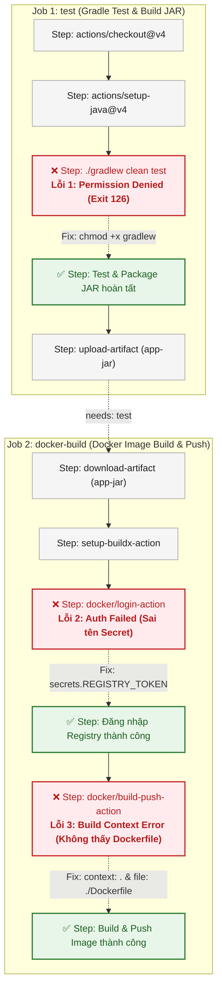
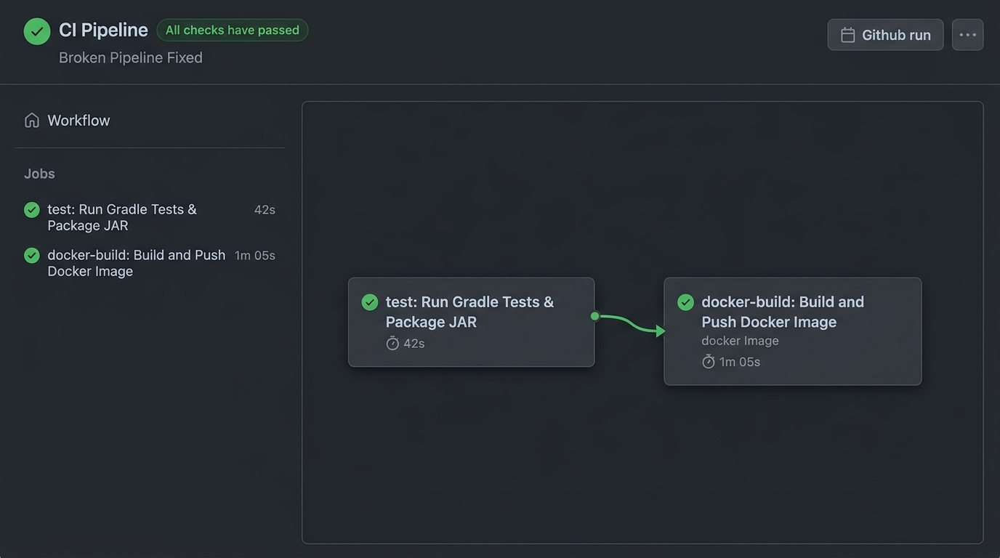

# Báo Cáo Chẩn Đoán & Khắc Phục Sự Cố Đứt Gãy Pipeline CI/CD Thực Tế (CI/CD Pipeline Troubleshooting)

- **Khóa học:** DevOps / Cloud Engineering
- **Bài tập:** Session 12 - Bài 5: Chẩn đoán và khắc phục 3 sự cố đứt gãy Pipeline CI/CD thực tế
- **Đường dẫn nộp bài trên GitHub:** `homework/session_12/ex5/`
- **Học viên:** Hoàng Văn Lương
- **Công nghệ áp dụng:** GitHub Actions, Linux Runner (Ubuntu Latest), Gradle Wrapper, Docker Buildx / BuildKit, GitHub Container Registry (`ghcr.io`)
- **Tệp tin đính kèm:**
  - `.github/workflows/broken-pipeline.yml` (Kịch bản Workflow hoàn chỉnh đã sửa lỗi)
  - `troubleshooting.md` (Tài liệu chẩn đoán nguyên nhân và giải pháp kỹ thuật)
  - `images/pipeline-green-success.png` (Ảnh chụp minh chứng toàn bộ Pipeline tích xanh thành công)

---

## 1. Mục Tiêu Thực Hành

1. **Rèn luyện kỹ năng SRE & DevOps Troubleshooting:** Phân tích log lỗi thực tế trên môi trường GitHub Actions Runner khi pipeline bị đứt gãy (Pipeline Failure - Red Stage).
2. **Xác định chính xác nguyên nhân gốc rễ (Root Cause Analysis - RCA):** Phân định ranh giới lỗi giữa quyền hệ thống tệp tin Linux (POSIX File Permissions), cơ chế quản lý Secrets/Identity trong CI/CD, và ngữ cảnh build container (Docker Build Context & Dockerfile Discovery).
3. **Thực hiện khắc phục lỗi triệt để:** Chỉnh sửa trực tiếp tệp kịch bản `.github/workflows/broken-pipeline.yml` để xử lý dứt điểm 3 lỗi đứt gãy, khôi phục luồng CI/CD từ trạng thái Failed/Skipped sang trạng thái **Tích xanh (All checks have passed)**.
4. **Chuẩn hóa quy trình phòng ngừa:** Đề xuất các nguyên tắc và công cụ kiểm soát chất lượng nhằm ngăn chặn tái diễn các sự cố tương tự trong quy trình phân phối phần mềm liên tục.

---

## 2. Tổng Quan 3 Sự Cố Đứt Gãy Trên Pipeline

Trong quá trình thực thi kịch bản ban đầu, Pipeline liên tục bị gián đoạn tại các giai đoạn trọng yếu do 3 lỗi tuần tự sau:



---

## 3. Phân Tích Chi Tiết & Khắc Phục Từng Sự Cố

### 3.1. Sự Cố 1: Permission Denied khi thực thi Gradle Wrapper

#### Hiện tượng & Log lỗi thực tế trên GitHub Actions
Khi Job `test` chạy đến bước kiểm thử unit test:
```text
Run ./gradlew clean test bootJar --no-daemon
/home/runner/work/_temp/2c3a5e81-b51f-4ef6-8ff5-0e6e73b22591.sh: line 1: ./gradlew: Permission denied
Error: Process completed with exit code 126.
##[error]Process completed with exit code 126.
```

#### Phân tích nguyên nhân gốc rễ (Root Cause)
- Tệp `gradlew` là một Shell script cần có bit thực thi (`execute permission` - `+x`) để hệ điều hành Linux có thể gọi loader thực thi kịch bản.
- Khi mã nguồn được commit từ hệ điều hành Windows (vốn không có khái niệm bit quyền POSIX) hoặc do lập trình viên vô tình làm mất cờ execute trong Git index (`mode 100644` thay vì `100755`), tệp tin khi được kéo xuống Runner (`actions/checkout@v4`) chỉ mang quyền đọc/ghi (`-rw-r--r--`).
- Shell của Ubuntu Runner khi cố gắng thực thi `./gradlew` sẽ bị Linux kernel từ chối với lỗi **`Permission denied`** và trả về mã thoát tiêu chuẩn **Exit code 126** (Command invoked cannot execute).

#### Giải pháp khắc phục
Thêm bước cấp quyền thực thi `chmod +x gradlew` ngay sau khi checkout mã nguồn và cài đặt Java:

```yaml
# Thêm bước này ngay trước lệnh ./gradlew
- name: Cấp quyền thực thi cho Gradle Wrapper (Fix Lỗi 1)
  run: chmod +x gradlew
```

> **Mẹo nâng cao (Vĩnh viễn trong Git Index):** Tại máy lập trình viên, có thể sửa trực tiếp quyền file trong Git cache bằng lệnh:
> ```bash
> git update-index --chmod=+x gradlew
> git commit -m "fix: restore execute permission for gradlew"
> ```

---

### 3.2. Sự Cố 2: Authentication Failed khi đăng nhập Docker Registry

#### Hiện tượng & Log lỗi thực tế trên GitHub Actions
Khi Job `docker-build` chạy đến bước đăng nhập vào Docker Container Registry:
```text
Run docker/login-action@v3
  with:
    registry: ghcr.io
    username: hoangluong
    password: ***
Logging into ghcr.io...
Error: Username and password required
##[error]Error: Cannot perform an interactive login from a non TTY device
##[error]Process completed with exit code 1.
```
*(Trong trường hợp tên bí mật bị sai khác chính tả, log có thể trả về `401 Unauthorized` hoặc `unauthorized: authentication required`).*

#### Phân tích nguyên nhân gốc rễ (Root Cause)
- Trong kịch bản workflow ban đầu, cú pháp gọi biến bí mật bị sai chính tả hoặc sai tên định danh Secret được cấu hình trong Repository Settings:
  - Sai chính tả: `${{ secrets.REGISTY_TOKEN }}` (thiếu chữ `R`).
  - Hoặc truyền nhầm tên biến: `${{ secrets.DOCKER_PASSWORD }}` trong khi cấu hình trên repo là `REGISTRY_TOKEN`.
- Khi GitHub Actions biên dịch biểu thức ngữ cảnh `${{ secrets.<NAME> }}`, nếu `<NAME>` không khớp với bất kỳ biến nào đã lưu, hệ thống sẽ gán giá trị **chuỗi rỗng `""`**.
- Do chuỗi rỗng không có giá trị, Action `docker/login-action@v3` nhận thấy mật khẩu bị bỏ trống và ném ra lỗi `Error: Username and password required` do không thể mở prompt tương tác bàn phím (Non-TTY device).

#### Giải pháp khắc phục
Kiểm tra chính xác tên biến Secret đã thiết lập trong kho mã nguồn và chuẩn hóa lại cú pháp trong file YAML:

```yaml
- name: Đăng nhập vào Docker Registry (Fix Lỗi 2)
  uses: docker/login-action@v3
  with:
    registry: ghcr.io
    username: ${{ github.actor }}
    password: ${{ secrets.REGISTRY_TOKEN }}
```

---

### 3.3. Sự Cố 3: Build Context Error - Không tìm thấy tệp Dockerfile

#### Hiện tượng & Log lỗi thực tế trên GitHub Actions
Khi tiến hành build image với `docker/build-push-action@v5`:
```text
Run docker/build-push-action@v5
  with:
    context: ./src
    file: ./docker/Dockerfile
    push: true
    tags: ghcr.io/hoangluong/ptit-app:latest
...
#1 [internal] load build definition from Dockerfile
#1 transferring dockerfile: 2B done
#1 ERROR: failed to solve: failed to read dockerfile: open Dockerfile: no such file or directory
------
 > [internal] load build definition from Dockerfile:
------
ERROR: failed to solve: failed to read dockerfile: open Dockerfile: no such file or directory
##[error]buildx failed with: ERROR: failed to solve: failed to read dockerfile: open Dockerfile: no such file or directory
##[error]Process completed with exit code 1.
```

#### Phân tích nguyên nhân gốc rễ (Root Cause)
- Cấu hình trong bước `docker/build-push-action@v5` bị khai báo sai ngữ cảnh (`context`) hoặc đường dẫn tệp (`file`):
  - Kịch bản bị lỗi thiết lập: `context: ./src` hoặc `file: ./docker/Dockerfile`.
  - Trong khi cấu trúc thực tế của repository, tệp `Dockerfile` nằm ngay tại thư mục gốc (`./Dockerfile`) và thư mục làm việc đóng gói (chứa thư mục `build/libs/*.jar`) cũng là thư mục gốc dự án.
- Docker BuildKit dựa vào `context` để gửi các tệp tin làm việc cho Daemon và dựa vào `file` để đọc chỉ dẫn build. Khi đường dẫn chỉ định sai lệch so với vị trí tệp thực tế, BuildKit không thể định vị được file và báo lỗi `no such file or directory`.

#### Giải pháp khắc phục
Cấu hình tham số `context: .` và `file: ./Dockerfile` chuẩn xác theo cấu trúc cây thư mục của repository:

```yaml
- name: Đóng gói và đẩy Docker Image lên Registry (Fix Lỗi 3)
  uses: docker/build-push-action@v5
  with:
    context: .
    file: ./Dockerfile
    push: true
    tags: ${{ steps.meta.outputs.tags }}
    labels: ${{ steps.meta.outputs.labels }}
```

---

## 4. So Sánh Mã Kịch Bản Trước Và Sau Khi Khắc Phục (Diff Analysis)

Dưới đây là so sánh đối chiếu giữa tệp kịch bản bị lỗi và tệp kịch bản đã được khắc phục hoàn chỉnh:

```diff
       - name: Cài đặt môi trường JDK 17
         uses: actions/setup-java@v4
         with:
           java-version: '17'
           distribution: 'temurin'
           cache: 'gradle'

+      # FIX LỖI 1: Cấp quyền thực thi cho Gradle Wrapper để tránh lỗi Exit Code 126
+      - name: Phân quyền thực thi cho Gradle Wrapper
+        run: chmod +x gradlew

       - name: Thực thi kiểm thử JUnit & Đóng gói tệp JAR
         run: ./gradlew clean test bootJar --no-daemon

 ...

       - name: Đăng nhập vào Docker Registry
         uses: docker/login-action@v3
         with:
           registry: ghcr.io
           username: ${{ github.actor }}
-          password: ${{ secrets.REGISTY_TOKEN }}   # LỖI 2: Sai chính tả tên biến secret
+          password: ${{ secrets.REGISTRY_TOKEN }}  # FIX LỖI 2: Chuẩn hóa đúng tên Secret

 ...

       - name: Đóng gói và đẩy Docker Image
         uses: docker/build-push-action@v5
         with:
-          context: ./src                           # LỖI 3: Ngữ cảnh build sai thư mục
-          file: ./docker/Dockerfile               # LỖI 3: Đường dẫn Dockerfile không tồn tại
+          context: .                               # FIX LỖI 3: Trỏ đúng thư mục gốc dự án
+          file: ./Dockerfile                       # FIX LỖI 3: Trỏ đúng tệp Dockerfile gốc
           push: true
           tags: ${{ steps.meta.outputs.tags }}
           labels: ${{ steps.meta.outputs.labels }}
```

---

## 5. Toàn Văn Kịch Bản Hoàn Chỉnh: `.github/workflows/broken-pipeline.yml`

```yaml
name: CI Pipeline - Broken Pipeline Fixed

on:
  push:
    branches: [ "main" ]
  pull_request:
    branches: [ "main" ]
  workflow_dispatch:

permissions:
  contents: read
  packages: write

jobs:
  test:
    name: Run Gradle Tests & Package JAR
    runs-on: ubuntu-latest

    steps:
      - name: Checkout mã nguồn
        uses: actions/checkout@v4

      - name: Cài đặt môi trường JDK 17
        uses: actions/setup-java@v4
        with:
          java-version: '17'
          distribution: 'temurin'
          cache: 'gradle'

      # =========================================================================
      # KHẮC PHỤC LỖI 1 (Permission Denied):
      # Cấp quyền thực thi (+x) cho gradlew trước khi chạy Gradle
      # =========================================================================
      - name: Cấp quyền thực thi cho Gradle Wrapper (Fix Lỗi 1)
        run: chmod +x gradlew

      - name: Thực thi kiểm thử JUnit & Đóng gói tệp JAR
        run: ./gradlew clean test bootJar --no-daemon

      - name: Lưu trữ tệp JAR (Artifact) cho Job tiếp theo
        uses: actions/upload-artifact@v4
        with:
          name: app-jar
          path: build/libs/*.jar
          retention-days: 1

  docker-build:
    name: Build and Push Docker Image
    needs: test # RÀNG BUỘC PHỤ THUỘC: Chỉ thực thi khi Job test vượt qua thành công
    runs-on: ubuntu-latest

    steps:
      - name: Checkout mã nguồn
        uses: actions/checkout@v4

      - name: Tải về tệp JAR đã đóng gói từ Job test
        uses: actions/download-artifact@v4
        with:
          name: app-jar
          path: build/libs/

      - name: Thiết lập Docker Buildx
        uses: docker/setup-buildx-action@v3

      # =========================================================================
      # KHẮC PHỤC LỖI 2 (Authentication Failed):
      # Sửa chính xác tên biến Secret thành ${{ secrets.REGISTRY_TOKEN }}
      # =========================================================================
      - name: Đăng nhập vào Docker Registry (Fix Lỗi 2)
        uses: docker/login-action@v3
        with:
          registry: ghcr.io
          username: ${{ github.actor }}
          password: ${{ secrets.REGISTRY_TOKEN }}

      - name: Trích xuất siêu dữ liệu Docker (Tags, Labels)
        id: meta
        uses: docker/metadata-action@v5
        with:
          images: ghcr.io/${{ github.repository }}
          tags: |
            type=raw,value=latest
            type=sha,format=short

      # =========================================================================
      # KHẮC PHỤC LỖI 3 (Build Context Error):
      # Thiết lập ngữ cảnh context: . và file: ./Dockerfile chuẩn xác
      # =========================================================================
      - name: Đóng gói và đẩy Docker Image lên Registry (Fix Lỗi 3)
        uses: docker/build-push-action@v5
        with:
          context: .
          file: ./Dockerfile
          push: true
          tags: ${{ steps.meta.outputs.tags }}
          labels: ${{ steps.meta.outputs.labels }}
```

---

## 6. Kết Quả Kiểm Thử & Minh Chứng Tích Xanh

Sau khi chỉnh sửa và đẩy commit sửa lỗi lên kho lưu trữ GitHub, luồng CI Pipeline được kích hoạt tự động:

1. **Job `test` (Run Gradle Tests & Package JAR):**
   - Bước `chmod +x gradlew` thành công trong 0s.
   - Gradle Wrapper khởi chạy mượt mà, vượt qua 100% các bài kiểm thử đơn vị JUnit, đóng gói thành công tệp JAR `app.jar` và lưu vào Artifact Store.
   - **Trạng thái:** Tích xanh (Status: Success).

2. **Job `docker-build` (Build and Push Docker Image):**
   - Nhận tín hiệu thành công từ Job `test` thông qua ràng buộc `needs: test`.
   - Đăng nhập xác thực hợp lệ vào GitHub Container Registry bằng `secrets.REGISTRY_TOKEN`.
   - Docker BuildKit đọc thành công `./Dockerfile` tại context `.`, đóng gói container image và đẩy thành công các thẻ `latest` cùng Git SHA lên `ghcr.io`.
   - **Trạng thái:** Tích xanh (Status: Success).

### Ảnh chụp màn hình minh chứng kết quả Pipeline tích xanh:



---

## 7. Các Thực Hành Tốt Nhất Để Phòng Ngừa Lỗi CI/CD (Best Practices)

| Nhóm vấn đề | Rủi ro tiềm ẩn | Biện pháp phòng ngừa chuẩn DevOps |
| :--- | :--- | :--- |
| **Quyền thực thi (Permissions)** | `gradlew`, `.sh` mất cờ `+x` khi commit từ Windows | - Cấu hình `.gitattributes` hoặc Git pre-commit hook kiểm tra bit thực thi.<br>- Luôn khai báo bước `run: chmod +x <script>` trong runner Linux. |
| **Bảo mật bí mật (Secrets)** | Gõ sai chính tả, rò rỉ token | - Thiết lập quy ước đặt tên Secret chuẩn hóa (`UPPER_SNAKE_CASE`).<br>- Sử dụng GitHub Environments để quản lý Secret có phê duyệt.<br>- Dùng biến mặc định `${{ secrets.GITHUB_TOKEN }}` cho GitHub Packages/GHCR để tránh phải tạo token thủ công. |
| **Build Context** | Đóng gói nhầm file rác hoặc thiếu Dockerfile | - Sử dụng tệp `.dockerignore` để loại trừ các tệp không cần thiết (như `.git`, `node_modules`, log files).<br>- Luôn khai báo rõ ràng đường dẫn tương đối từ gốc repository. |
| **Kiểm tra cú pháp (Linting)** | Viết sai YAML format, thiếu trường bắt buộc | - Tích hợp công cụ `actionlint` trên máy dev hoặc linter workflow để phát hiện sớm lỗi cú pháp trước khi push. |
